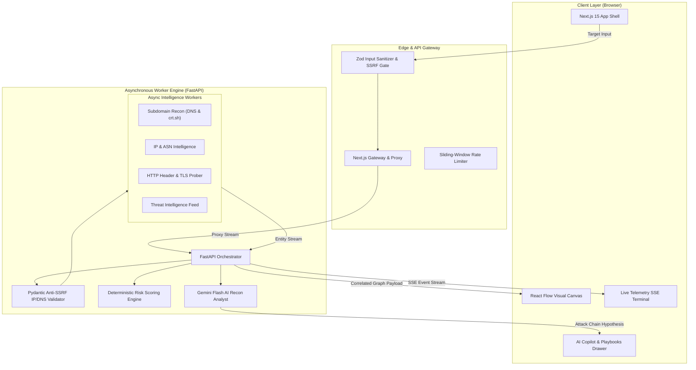

<p align="center">
  
</p>

<h1 align="center">ISEEYOU</h1>

<p align="center">
  <strong>Next-Gen Automated OSINT &amp; External Attack Surface Intelligence Platform</strong>
</p>

<p align="center">
  <a href="https://github.com/felixpalingan/ISEEYOU/actions/workflows/ci.yml"></a>
  <a href="LICENSE"></a>
  
  
  
  
  
  
</p>

---

## 👁️ Executive Overview

**ISEEYOU** is an enterprise-grade Open Source Intelligence (OSINT) and External Attack Surface Management (EASM) command center engineered to eliminate reconnaissance tool fragmentation. 

Traditional security auditing often requires pivoting across dozens of isolated command-line tools, Certificate Transparency web portals, DNS inspectors, and manual diagramming software. **ISEEYOU** unifies multi-vector passive intelligence ingestion into a high-performance, real-time reactive canvas—correlating subdomains, DNS infrastructure, IP geolocation, ASN networks, and exposed assets in under 8 seconds.

Equipped with an AI Recon Analyst (powered by Google Gemini Flash), 1-click firewall remediation generators (UFW, Nginx, Apache, Cloudflare WAF), statutory legal privacy takedown workflows (Indonesia UU PDP No. 27/2022 and EU GDPR), and an audit-grade PDF exporter, ISEEYOU bridges the gap between passive discovery and immediate operational defense.

---

## ⚡ Key Highlights

- **Interactive Pivot Graph:** Dynamic, force-directed entity relationship visualization built on `@xyflow/react` with node clustering, severity indicators, and real-time layout updates.
- **Real-Time Telemetry Terminal:** Sub-second Server-Sent Events (SSE) telemetry stream providing granular, color-coded audit logs from asynchronous Python worker meshes.
- **Deterministic Risk Scoring:** Multi-factor scoring algorithm calculating exposure severity (0–100) based on exposed services, misconfigured security headers, and domain age.
- **AI Recon Analyst & Attack Chain Copilot:** Instant synthesis of attack vectors and executive summaries powered by Google Gemini Flash API.
- **1-Click Tactical Remediation:** Instant copy-paste firewall rules for immediate perimeter lockdown across UFW, Nginx, Apache, and Cloudflare WAF.
- **Statutory Legal Takedowns:** Automated generation of formal data removal notices complying with Indonesia's **UU Perlindungan Data Pribadi (UU PDP No. 27/2022)** and the **EU GDPR**, complete with direct Google Search Console de-indexing shortcuts.
- **Forensic PDF Audit Report Exporter:** Single-click export producing professional, publication-ready security audit reports for CISOs and compliance auditors.
- **Enterprise Anti-SSRF Defense:** Zero-trust sanitization and kernel-level network validation blocking loopback (`127.0.0.1`), RFC 1918 subnets, cloud metadata (`169.254.169.254`), and DNS rebinding attacks.

---

## 📊 Feature Comparison Matrix

| Capability / Feature | **ISEEYOU** | **Maltego** | **SpiderFoot** | **Recon-ng** | **OWASP Amass** |
| :--- | :---: | :---: | :---: | :---: | :---: |
| **Modern Web UI & Canvas** | ✅ React Flow / Next.js 15 | ❌ Heavy Java Desktop | ⚠️ Legacy Web UI | ❌ CLI Only | ❌ CLI Only |
| **Real-Time SSE Streaming** | ✅ Sub-second direct stream | ❌ Polling / Batch | ⚠️ Polling | ❌ Console stdout | ❌ Console stdout |
| **AI Attack Chain Synthesis** | ✅ Gemini Flash Copilot | ❌ None | ❌ None | ❌ None | ❌ None |
| **1-Click Firewall Remediation** | ✅ UFW / Nginx / Cloudflare | ❌ None | ❌ None | ❌ None | ❌ None |
| **Statutory Legal Takedown (UU PDP & GDPR)** | ✅ Built-in Generator | ❌ None | ❌ None | ❌ None | ❌ None |
| **Enterprise Anti-SSRF Guard** | ✅ Dual-layer (Zod + Pydantic) | ⚠️ Network dependent | ❌ Weak / Open | ❌ None | ❌ None |
| **Forensic PDF Audit Export** | ✅ Standard Vector PDF | ⚠️ Commercial tier | ⚠️ Basic HTML dump | ❌ None | ❌ None |
| **100% Passive by Default** | ✅ Guaranteed non-intrusive | ⚠️ Depends on transforms | ⚠️ Often active scans | ⚠️ Mix of active/passive | ⚠️ Active DNS queries |
| **Docker Compose 1-Click Spinup** | ✅ Single command | ❌ Complex license/server | ⚠️ Partial Docker | ❌ Python manual install | ⚠️ Container CLI |

---

## 🏗️ System Architecture



### Detailed Vector Architecture Diagrams

Detailed architectural schematics are available in the [`docs/diagrams/`](docs/diagrams/) directory:
- [**System Topology & Architecture**](docs/diagrams/topology.svg): Full multi-tier deployment topology spanning Browser, Edge, API Gateway, Worker Mesh, and Data Layers.
- [**Reconnaissance Data Flow**](docs/diagrams/recon_flow.svg): Sequential data pipeline from target ingestion, certificate transparency scraping, reverse DNS lookup, to risk scoring.
- [**Entity-Relationship Model (ERD)**](docs/diagrams/erd.svg): Relational schema illustrating scans, targets, entity nodes, relationships, and threat indicators.
- [**UI Layout & Component Hierarchy**](docs/diagrams/ui_mockup.svg): Component design layout showcasing the OmniSearchBar, Visual Canvas, Live Terminal, and Intelligence Drawer.

---

## 🛠️ Technology Stack

| Layer | Technologies | Rationale |
| :--- | :--- | :--- |
| **Frontend Framework** | **Next.js 15 (App Router)**, React 19, TypeScript 5.7+ | Server-side rendering, streaming responses, type safety, and modern performance optimizations. |
| **Graph Visualization** | **@xyflow/react (React Flow v12)** | Industry-standard canvas for high-density, interactive node-link network graphs. |
| **UI Design System** | **Tailwind CSS**, Lucide Icons, Radix UI Primitives | Responsive cyber-ops aesthetic with high contrast, glassmorphism, and accessible controls. |
| **Worker Engine** | **Python 3.11+**, **FastAPI**, **Asyncio**, **HTTPX** | High-concurrency asynchronous I/O optimized for parallel network probing and streaming. |
| **Intelligence Feeds** | **crt.sh**, Authoritative DoH (Cloudflare/Google), Public GeoIP/ASN | 100% passive, reliable, zero-cost OSINT sources adhering to standard network protocols. |
| **AI Copilot** | **Google Gemini Flash API** | Ultra-low latency contextual attack surface summarization and threat scenario drafting. |
| **Security Engineering** | **Zod**, **Pydantic v2**, `ipaddress` validation | Strict multi-layered sanitization preventing SSRF, command injection, and denial of service. |
| **Containerization** | **Docker**, **Docker Compose** | Reproducible multi-stage builds ensuring identical execution across macOS, Linux, and Windows. |

---

## 🚀 Quickstart Guide

### Option 1: Single-Command Docker Compose (Recommended)

The fastest way to launch ISEEYOU in production mode is using Docker Compose:

```bash
# 1. Clone repository
git clone https://github.com/felixpalingan/ISEEYOU.git
cd ISEEYOU

# 2. Copy environment configuration
cp .env.example .env

# 3. Spin up full stack
docker compose up --build
```

Once running:
- **Web Application:** `http://localhost:3000`
- **FastAPI Worker Engine & OpenAPI Docs:** `http://localhost:8000/docs`

---

### Option 2: Local Monorepo Development

If you wish to modify source code and develop locally:

#### Prerequisites
- **Node.js** >= 20.x
- **Python** >= 3.11
- **npm** >= 10.x

#### 1. Setup Monorepo & Dependencies
```bash
# Install root and workspace dependencies
npm install

# Build shared TypeScript types
npm run build:types
```

#### 2. Start FastAPI Worker Engine
```bash
# Setup Python virtual environment
cd apps/worker-engine
python -m venv .venv

# Activate virtual environment
# On Linux / macOS:
source .venv/bin/activate
# On Windows:
.venv\Scripts\Activate.ps1

# Install Python requirements
pip install -r requirements.txt

# Launch FastAPI development server
$env:PYTHONPATH="."  # Windows PowerShell
python -m uvicorn engine.main:app --host 0.0.0.0 --port 8000 --reload
```

#### 3. Start Next.js Web Application
In a separate terminal:
```bash
# Run Next.js in development mode
npm run dev --workspace=apps/web
```

Open `http://localhost:3000` in your browser.

---

## 🔒 Enterprise Security & SSRF Defense

ISEEYOU is built with defense-in-depth principles. Because reconnaissance tools make outbound network requests, robust controls are implemented to protect internal networks:

```
[Target Input]
      │
      ▼
┌────────────────────────────────────────────────────────┐
│ Layer 1: Client & Gateway Sanitization (Zod)           │
│ - Strips protocols (http/https), path, query, & ports  │
│ - Pre-flight regex blocks loopbacks and private blocks │
└────────────────────────────────────────────────────────┘
      │
      ▼
┌────────────────────────────────────────────────────────┐
│ Layer 2: Worker Engine Anti-SSRF Gate (Pydantic & IP)  │
│ - Strict ipaddress.ip_address() validation             │
│ - Blocks RFC 1918 (10.0.0.0/8, 172.16/12, 192.168/16)  │
│ - Blocks Link-Local & Cloud Metadata (169.254.169.254) │
│ - Blocks Loopbacks (127.0.0.0/8, ::1) & Multicast      │
│ - Blocks DNS Rebinding (*.nip.io, *.sslip.io)          │
└────────────────────────────────────────────────────────┘
      │
      ▼
┌────────────────────────────────────────────────────────┐
│ Layer 3: Sliding-Window Rate Limiting                  │
│ - 30 requests / minute per client IP                   │
│ - Throttles abuse on live direct streaming endpoints   │
└────────────────────────────────────────────────────────┘
      │
      ▼
[Safe Outbound Passive Request to Authoritative Sources]
```

---

## 🧪 Automated Testing & Quality Assurance

ISEEYOU maintains a 100% passing automated test suite enforced via continuous integration:

- **Python Backend Unit & Security Tests:**
  ```bash
  python -m pytest apps/worker-engine/tests -v
  # 64 passed tests covering engine models, Anti-SSRF gates, and OSINT providers
  ```

- **Playwright End-to-End (E2E) Browser Tests:**
  ```bash
  npx playwright test --config=apps/web/playwright.config.ts
  # 12 passed E2E tests validating graph rendering, telemetry streams, and security badges
  ```

- **Continuous Integration Pipeline:** Every commit and pull request triggers a multi-job GitHub Actions workflow checking linting, shared types compilation, Python unit tests, Playwright browser execution, and Docker buildx verification.

---

## ⚖️ Legal & Ethical Usage Disclaimer

> [!IMPORTANT]
> **ISEEYOU is designed strictly for defensive security operations, attack surface monitoring, and authorized reconnaissance.**

1. **Passive Reconnaissance**: All native modules query publicly accessible records (DNS records, public Certificate Transparency logs, whois information, and open threat feeds). ISEEYOU does not perform intrusive vulnerability exploitation, brute-forcing, or denial-of-service attacks.
2. **Authorized Use**: Users are solely responsible for ensuring that their use of this software complies with applicable local, state, national, and international laws (including the CFAA, GDPR, and Indonesia's UU ITE & UU PDP).
3. **No Warranty**: The software is provided "AS IS", without warranty of any kind. Maintainers assume no liability for misuse.

---

## 📄 Documentation & Governance

- [Contributing Guidelines](CONTRIBUTING.md) — Learn how to set up the dev environment, write tests, and submit PRs.
- [Security Policy](SECURITY.md) — Procedures for reporting security vulnerabilities responsibly.
- [Deployment Guide](docs/DEPLOYMENT.md) — Cloud deployment guides for Vercel, Railway, Render, and self-hosted Docker VPS.
- [License](LICENSE) — Licensed under the permissive MIT License.

---

## 👤 Author & Maintainer

Crafted with dedication by **Felix Palingan** ([@felixpalingan](https://github.com/felixpalingan)).

If you find ISEEYOU valuable for your security operations, please consider giving the repository a ⭐️ star on GitHub!
