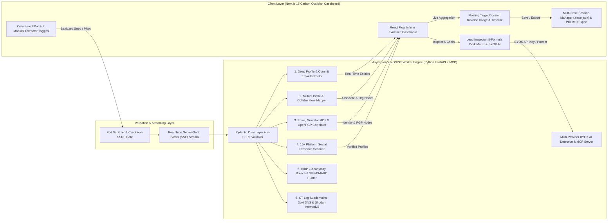

<p align="center">
  
</p>

<h1 align="center">ISEEYOU 2.0</h1>

<p align="center">
  <strong>Interactive OSINT Lead-Chaining Caseboard, Target Dossier Workbench &amp; AI Detective</strong>
</p>

<p align="center">
  <a href="https://github.com/felixpalingan/ISEEYOU/actions/workflows/ci.yml"></a>
  <a href="LICENSE"></a>
  
  
  
  
  
  
</p>

---

## 👁️ Overview

**ISEEYOU 2.0** is an interactive Open Source Intelligence (OSINT) Lead-Chaining Caseboard, Target Dossier Workbench, and External Attack Surface Management (EASM) platform engineered for security researchers, red-team analysts, and digital investigators.

Instead of running isolated CLI tools and losing track of scattered clues, **ISEEYOU 2.0** turns every discovered attribute into an actionable graph lead on a full-screen infinite canvas:
- Start from a single **Username**, **Email Address**, **Domain**, or **Public IP**.
- Automatically extract **Real Names, Avatars, Bios, Locations, Organizations, and Hidden Commit Emails** from public developer and social APIs.
- Map a target's **Inner Circle (2-Way Mutual Connections & Repository Co-Authors)** to uncover real-world associates.
- Pivot from **Emails to Gravatar MD5 Profiles, OpenPGP Keyserver UIDs, and k-Anonymity Breach Records**.
- Bypass private social media walls using the **8-Formula Tactical Google Dork Matrix** (`site:`, `intext:`, `-inurl:`, `filetype:`) to surface public third-party comments, friend tags, and leaked PDF/XLSX rosters.
- Run **1-Click Reverse Image Search** across **Google Lens, Yandex Images, Bing Visual, and TinEye** on any discovered or custom photo URL.
- Correlate clues and predict alternate handles using the **Multi-Provider BYOK AI Detective** (`Gemini`, `Groq`, `OpenAI / OpenRouter`, or local `Ollama`) or connect external AI agents via the built-in **Model Context Protocol (MCP) Server**.

---

## 🏗️ System Architecture



### Technology Stack

| Layer | Technologies | Engineering Rationale |
| :--- | :--- | :--- |
| **Frontend Caseboard** | **Next.js 15 (App Router)**, React 19, TypeScript 5.7+ | Streaming UI, strict type safety via `@iseeyou/shared-types`, and zero-latency state management. |
| **Graph Visualization** | **@xyflow/react (React Flow v12)** | Infinite canvas with deterministic Axis-Aligned Bounding Box (AABB) anti-overlap layout engine (`Tree` & `Radial`). |
| **Design System** | **Tailwind CSS**, Carbon Obsidian Tokens, Lucide Icons | High-contrast, low-noise tactical interface with `tabular-nums` alignment and keyboard-first navigation (`/`). |
| **OSINT Worker Engine** | **Python 3.11+**, **FastAPI**, **Asyncio**, **HTTPX** | High-concurrency asynchronous I/O for non-blocking multi-source OSINT extraction and SSE streaming. |
| **AI Detective & MCP** | **Gemini**, **Groq**, **OpenAI/OpenRouter**, **Ollama**, **MCP** | Bring-Your-Own-Key (BYOK) multi-provider LLM routing plus a standard JSON-RPC 2.0 stdio MCP server. |
| **Security & Testing** | **Zod**, **Pydantic v2**, **Pytest**, **Playwright** | Dual-layer Anti-SSRF network protection backed by 79 Python unit tests and 12 Playwright E2E browser tests. |

---

## ⚡ System Features & Capabilities

### 1. Step-by-Step OSINT Lead-Chaining Extractors
- **Deep Profile & Commit Email Extractor (`deep_profile_extractor.py`):** Queries GitHub (`/users/{u}` and `/users/{u}/events/public`), Reddit (`about.json`), Keybase (`user/lookup.json`), GitLab, HackerNews, and Dev.to to extract real names, avatars, bios, locations, organizations, account creation dates, cryptographic proofs, and hidden personal email addresses embedded in public Git commit payloads.
- **Inner Circle & Mutual Connections Mapper (`connection_mapper.py`):** Computes the intersection of `followers ∩ following` alongside repository co-authors and public organization memberships to map a target's verified mutual associates.
- **Email-to-Identity Correlator (`email_correlator.py`):** Computes MD5 hashes for Gravatar profile/avatar extraction, queries the Ubuntu OpenPGP HKP keyserver for registered full names and UIDs, searches GitHub commits by author email, and isolates custom organization domains.
- **16+ Platform Concurrent Social Scanner (`social_scanner.py`):** Probes username presence across major developer, creative, and community platforms with false-positive status verification.
- **Infrastructure & Breach Intelligence:** Combines Certificate Transparency (`crt.sh` / CertSpotter), Cloudflare DNS-over-HTTPS (DoH), Shodan InternetDB open port/CVE lookups, and HaveIBeenPwned k-Anonymity breach checks.

### 2. Tactical Google Dork Matrix (Private Account Comment & Tag Bypass)
Even when a target's Instagram, TikTok, or X account is locked or private, public comments and friend tags on third-party posts remain indexed by search engines. The built-in Dork Matrix automatically crafts 8 targeted queries using discovered handles, real names, emails, and organizations:
- `site:instagram.com "{handle}" -inurl:instagram.com/{handle}` — Third-party Instagram mentions and comment threads excluding the target's own profile URL.
- `site:instagram.com/p/ "{handle}" OR site:instagram.com/reel/ "{handle}"` — Public Instagram photo posts and Reels where the target commented or was tagged.
- `site:tiktok.com "{handle}" -inurl:"@{handle}"` — Public TikTok video replies, duets, and caption mentions.
- `(site:x.com OR site:twitter.com) "{handle}" -inurl:{handle}/status` — Public replies and thread mentions addressing a protected X/Twitter account.
- `site:linkedin.com/posts/ "{realName}" OR "{handle}"` — Public LinkedIn post activity and colleague tags.
- `site:linkedin.com/in/ "{realName}" "{organization}"` — Professional career and university identity matching.
- `("{realName}" OR "{handle}" OR "{email}") (filetype:pdf OR filetype:xlsx OR filetype:docx)` — Indexed university rosters, event attendance sheets, CVs, and organizational directories.
- `(site:linktr.ee OR site:carrd.co OR site:pastebin.com OR site:t.me OR site:reddit.com) "{handle}"` — Bio-link aggregators, public Telegram channels, and paste archives.

### 3. Live Target Dossier, Visual Reverse Image Search & Timeline
- **1-Click Avatar Reverse Image Search:** Launch visual identity lookups across **Google Lens**, **Yandex Images**, **Bing Visual Search**, and **TinEye** from any discovered avatar or paste a custom target photo URL directly into the Dossier card.
- **Multi-Avatar Switcher & Chronological Footprint:** Compare avatars across platforms and inspect the target's chronological digital history sorted from earliest account creation to latest activity.
- **Investigator Sticky Notes & Confidence Tagging:** Tag any evidence card on the board as `Verified`, `Suspected`, or `False Positive`, attach detective notes, or pin manually discovered clues (`+ Spawn on Board`).

### 4. Multi-Provider BYOK AI Detective & MCP Server
- **Bring-Your-Own-Key (BYOK) UI:** Configure your preferred API key (`Google Gemini`, `Groq Cloud`, `OpenAI / OpenRouter`, or local `Ollama`) directly in the browser to synthesize identity hypotheses, predict 5–8 alternate username/email variations with 1-click `Hunt →` triggers, and generate custom Google Dorks.
- **Model Context Protocol (MCP) Server (`mcp_server.py`):** Exposes 5 native OSINT tools (`osint_deep_profile`, `osint_map_mutuals`, `osint_correlate_email`, `osint_scan_socials`, `osint_generate_dorks`) over JSON-RPC 2.0 stdio for Claude Desktop, Cursor, and AI agents.

### 5. Case Session Persistence (`.case.json`) & Statutory Reporting
- **Portable Case Files (`.case.json`):** Save multiple ongoing investigations in browser storage or export/import complete `.case.json` snapshots containing all nodes, edges, confidence tags, and detective notes.
- **Vector A4 PDF & Markdown Dossier Export:** Generate TLP-marked (`TLP:RED`, `TLP:AMBER`, `TLP:GREEN`, `TLP:CLEAR`) PDF audit reports and `.md` Target Dossiers, complete with statutory privacy takedown notices under **Indonesia UU PDP No. 27/2022** and **EU GDPR Article 17**.

---

## 🚀 Local Development Setup

### Option 1: Docker Compose (Quickest)

```bash
# 1. Clone the repository
git clone https://github.com/felixpalingan/ISEEYOU.git
cd ISEEYOU

# 2. Copy the environment template
cp .env.example .env

# 3. Build and start the full stack
docker compose up --build
```

### Option 2: Manual Monorepo Development

#### Prerequisites
- **Node.js** >= 20.x & **npm** >= 10.x
- **Python** >= 3.11

#### 1. Install Dependencies & Build Shared Types
```bash
npm install
npm run build:types
```

#### 2. Start the FastAPI OSINT Worker Engine
```bash
cd apps/worker-engine
pip install -r requirements.txt

# Linux / macOS:
PYTHONPATH=. python -m uvicorn engine.main:app --host 127.0.0.1 --port 8000 --reload

# Windows PowerShell:
$env:PYTHONPATH="."; python -m uvicorn engine.main:app --host 127.0.0.1 --port 8000 --reload
```

#### 3. Start the Next.js 15 Caseboard Web App
```bash
# In a second terminal from the repository root:
npm run dev --workspace=apps/web
```
Open **`http://localhost:3000`** in your browser.

#### 4. Running the MCP Server (Optional for External AI Agents)
```bash
python -m engine.mcp_server
```

---

## 🧪 Automated Testing & Verification

```bash
# 1. Run Python Worker Engine Unit & Anti-SSRF Security Tests (79 passed)
python -m pytest apps/worker-engine/tests -v

# 2. Build Next.js Production Bundle
npm run build --workspace=apps/web

# 3. Run Playwright End-to-End Browser Suite (12 passed)
npx --workspace=apps/web playwright test
```

---

## 📄 Documentation & Governance

- [License](LICENSE) — Released under the MIT License.
- [Contributing Guidelines](CONTRIBUTING.md) — Development workflow, coding standards, and pull request process.
- [Security Policy](SECURITY.md) — Responsible vulnerability disclosure and Anti-SSRF security architecture.
- [Deployment Guide](docs/DEPLOYMENT.md) — Production deployment instructions for Docker, Railway, Render, and Vercel.

---

## 👤 Author

Crafted by **Felix Palingan** ([@felixpalingan](https://github.com/felixpalingan)) • 2026.
